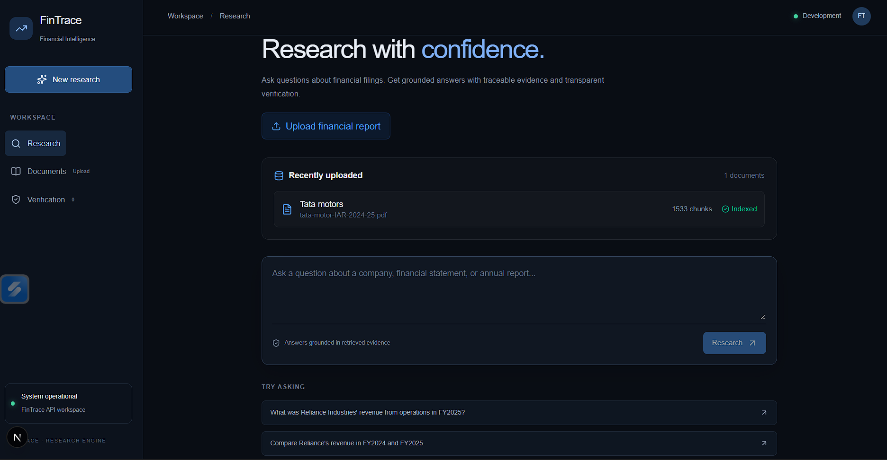
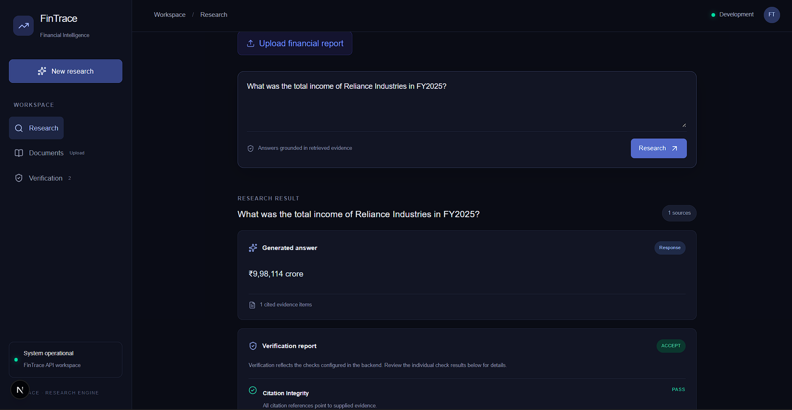
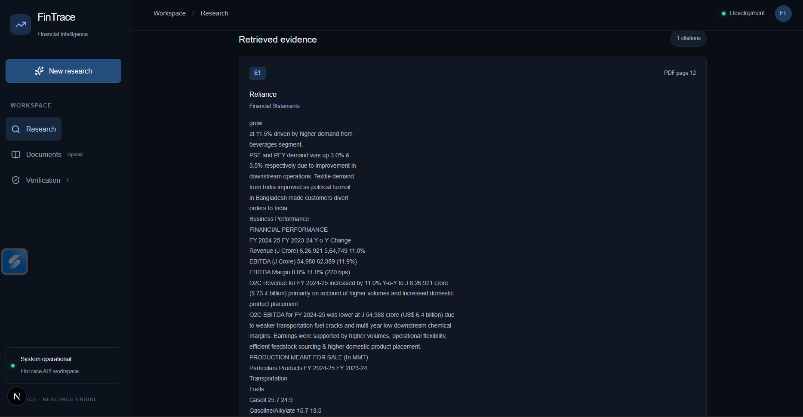
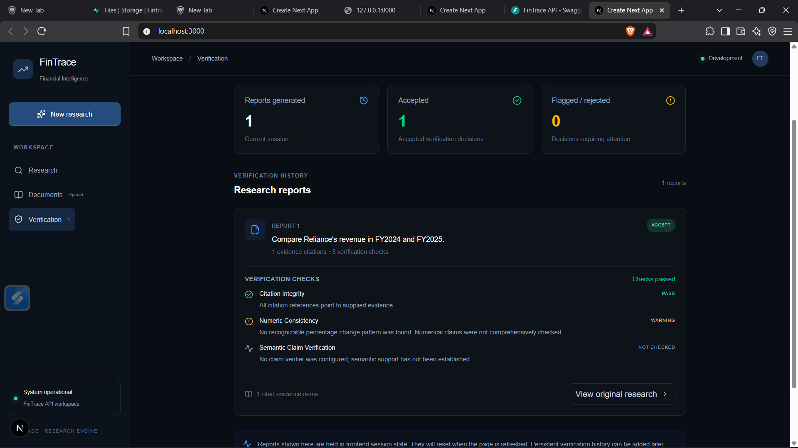
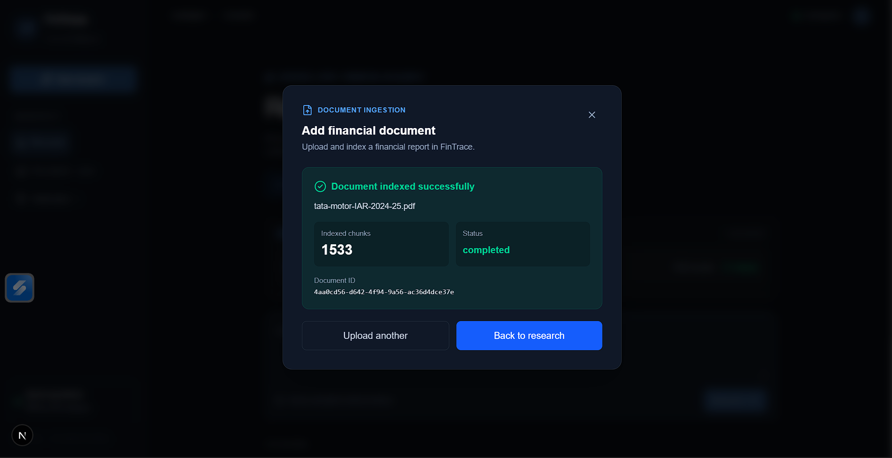
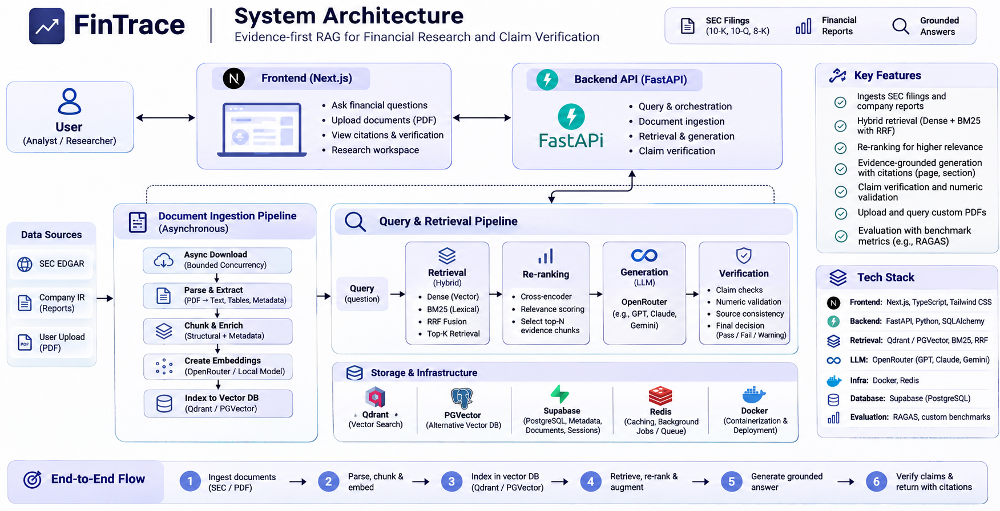
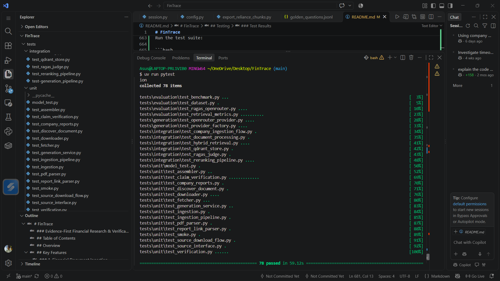

# FinTrace

### Evidence-First Financial Research & Verification System

FinTrace is an evidence-first financial RAG application designed to answer questions about company financial reports using retrieved document evidence, source citations, and automated claim verification.

Instead of relying entirely on an LLM's internal knowledge, FinTrace retrieves relevant passages from financial documents, generates answers grounded in that evidence, and verifies the generated claims before returning the response.

<p align="center">
  <!-- IMAGE 1: Main application dashboard screenshot -->
  
</p>

<p align="center">
  <b>Evidence-grounded answers · Hybrid retrieval · Citation validation · Claim verification</b>
</p>

---

## Table of Contents

- [Overview](#overview)
- [Key Features](#key-features)
- [Application Screenshots](#application-screenshots)
- [System Architecture](#system-architecture)
- [How FinTrace Works](#how-fintrace-works)
- [Retrieval Pipeline](#retrieval-pipeline)
- [Verification Pipeline](#verification-pipeline)
- [Technology Stack](#technology-stack)
- [Project Structure](#project-structure)
- [Getting Started](#getting-started)
- [Environment Variables](#environment-variables)
- [Running with Docker](#running-with-docker)
- [API Endpoints](#api-endpoints)
- [Evaluation](#evaluation)
- [Engineering Decisions](#engineering-decisions)
- [Current Limitations](#current-limitations)
- [Future Improvements](#future-improvements)

---

## Overview

Financial reports contain large amounts of structured and unstructured information, making it difficult to locate specific figures, compare financial performance, and verify statements across documents.

FinTrace addresses this problem through a retrieval-augmented generation architecture built specifically around financial documents.

The system allows users to:

1. Upload financial PDF documents.
2. Extract and process document content.
3. Generate embeddings and index document chunks.
4. Retrieve relevant evidence using hybrid search.
5. Generate answers using an LLM.
6. Validate citations and verify generated claims.
7. Explore previously uploaded documents.

The central design principle is:

**An answer should be supported by retrievable evidence, and its claims should be independently checked before being presented as reliable.**

---

## Key Features

### 1. Financial Document Ingestion

- Upload financial PDF reports.
- Extract document text and metadata.
- Split documents into searchable chunks.
- Generate vector embeddings.
- Store original PDFs in Supabase Storage.
- Store document metadata in PostgreSQL.
- Index document chunks in Qdrant.

### 2. Hybrid Information Retrieval

FinTrace combines multiple retrieval techniques:

- **Dense Retrieval:** Semantic similarity using BGE embeddings.
- **Sparse Retrieval:** Keyword-based retrieval using BM25.
- **Reciprocal Rank Fusion:** Combines ranked results from dense and sparse retrieval.
- **Cross-Encoder Reranking:** Reorders retrieved candidates based on query-document relevance.

### 3. Evidence-Grounded Generation

The generation pipeline provides the LLM with retrieved evidence rather than asking it to answer from general knowledge alone.

- Context-based answer generation.
- Structured answer parsing.
- Evidence-linked citations.
- Support for abstaining when sufficient evidence is unavailable.

### 4. Automated Verification

Generated answers pass through a verification pipeline.

- Citation validation.
- Claim extraction.
- Claim-to-evidence verification.
- Numeric consistency checks.
- Verification decisions: ACCEPT, FLAG, REJECT, or ABSTAIN.

### 5. Document Management

- Upload and store financial documents.
- Maintain document metadata.
- Retrieve previously uploaded documents.
- Access stored PDF files.
- Track document indexing status.

### 6. Retrieval Evaluation

FinTrace includes a retrieval benchmarking pipeline to evaluate retrieval strategies using:

- Hit Rate@K
- Precision@K
- Recall@K
- Mean Reciprocal Rank (MRR)
- Normalized Discounted Cumulative Gain (nDCG)
- Mean retrieval latency

---

## Application Screenshots

### 1. Main Dashboard

<!-- IMAGE 2: Main dashboard / research workspace -->
<p align="center">
  
</p>

### 2. Financial Query and Generated Answer

<!-- IMAGE 3: Example query and generated answer -->
<p align="center">
  
</p>

### 3. Evidence and Citations

<!-- IMAGE 4: Retrieved evidence and citations -->
<p align="center">
  
</p>

### 4. Verification Results

<!-- IMAGE 5: Verification results -->
<p align="center">
  
</p>

### 5. Uploaded Documents

<!-- IMAGE 6: Document history / uploaded PDFs -->
<p align="center">
  
</p>

---

## System Architecture

<!-- IMAGE 7: Architecture diagram -->
<p align="center">
  
</p>

The system is organized into independent components responsible for ingestion, retrieval, generation, and verification.

### Main Components

| Component | Responsibility |
|---|---|
| Next.js Frontend | Research interface, document upload, and results visualization |
| FastAPI Backend | API layer and application orchestration |
| Ingestion Pipeline | PDF processing, extraction, and chunking |
| Embedding Provider | Converts text into vector representations |
| Qdrant | Stores and retrieves dense vector embeddings |
| BM25 Retriever | Performs sparse keyword retrieval |
| RRF Fusion | Combines dense and sparse rankings |
| Cross-Encoder | Reranks retrieved candidates |
| Generation Service | Generates evidence-grounded answers |
| Verification Service | Validates citations and generated claims |
| PostgreSQL | Stores document metadata |
| Supabase Storage | Stores uploaded PDF files |

---

## How FinTrace Works

### Step 1: Document Ingestion

A user uploads a financial PDF.

The ingestion pipeline:

1. Receives the document.
2. Extracts its text and metadata.
3. Processes the extracted content.
4. Splits the document into chunks.
5. Generates embeddings.
6. Stores the original PDF and document metadata.
7. Indexes the chunks in Qdrant.

### Step 2: Query Processing

When a user submits a financial question:

1. The query is converted into an embedding.
2. Dense retrieval searches Qdrant.
3. BM25 performs sparse retrieval.
4. Reciprocal Rank Fusion combines the rankings.
5. The Cross-Encoder reranks the retrieved candidates.

### Step 3: Answer Generation

The generation service receives the question and retrieved evidence.

The LLM generates a structured response containing:

- Answer text.
- Evidence references.
- Citation identifiers.
- Abstention status.

The answer parser validates the generated structure and citation references.

### Step 4: Verification

The verification service evaluates the generated answer.

It performs citation validation, claim extraction, claim verification, and numeric validation.

The system then produces a verification decision based on the implemented checks.

---

## Retrieval Pipeline

FinTrace uses a hybrid retrieval architecture to combine semantic and lexical search.

### Dense Retrieval

**Model:** `BAAI/bge-small-en-v1.5`

Dense retrieval converts queries and document chunks into 384-dimensional vector embeddings.

Qdrant performs similarity search using cosine distance.

### Sparse Retrieval

**Algorithm:** BM25

BM25 retrieves documents based on lexical matching between the query and indexed document chunks.

This is particularly useful for financial information containing:

- Financial years.
- Company names.
- Financial terminology.
- Numerical references.
- Specific accounting terms.

### Reciprocal Rank Fusion

Dense and sparse retrieval results are combined using Reciprocal Rank Fusion.

The fusion score is calculated as:

\[
RRF(d) = \sum_{r \in R} \frac{1}{k + rank_r(d)}
\]

Where:

- \(d\) represents a document chunk.
- \(R\) represents the retrieval result lists.
- \(rank_r(d)\) represents the rank of the chunk in a result list.
- \(k\) is the RRF constant.

### Cross-Encoder Reranking

The retrieved candidates are passed through:

`BAAI/bge-reranker-base`

The Cross-Encoder evaluates query-document relevance and reranks the candidates.

This provides a second-stage relevance assessment after initial retrieval.

---

## Verification Pipeline

A key part of FinTrace is separating answer generation from answer verification.

The verification pipeline contains the following components:

| Component | Purpose |
|---|---|
| Citation Validator | Checks whether citations reference valid evidence |
| Claim Extractor | Extracts individual claims from generated answers |
| Claim Verifier | Evaluates claims against retrieved evidence |
| Numeric Validator | Checks numerical consistency |
| Verification Service | Combines verification results into a final decision |

### Verification Decisions

| Decision | Meaning |
|---|---|
| ACCEPT | Answer satisfies the implemented verification requirements |
| FLAG | Answer requires attention because of verification warnings |
| REJECT | Answer fails one or more verification requirements |
| ABSTAIN | Sufficient evidence is unavailable to support an answer |

The verification process is intended to reduce unsupported statements and improve the reliability of generated financial answers.

---

## Technology Stack

### Backend

- Python 3.12
- FastAPI
- SQLAlchemy
- Pydantic
- Alembic
- Pytest

### Retrieval and AI

- Sentence Transformers
- BAAI BGE Small Embeddings
- BAAI BGE Cross-Encoder Reranker
- BM25
- Reciprocal Rank Fusion
- Qdrant
- LangChain (evaluation orchestration)

### Database and Storage

- PostgreSQL
- Supabase
- Supabase Storage

### Frontend

- Next.js
- React
- TypeScript
- Tailwind CSS

### Infrastructure and Development

- Docker
- Docker Compose
- uv
- Git
- GitHub

---

## Project Structure

```text
FinTrace/
│
├── src/
│   └── fintrace/
│       ├── api/
│       │   ├── routes/
│       │   ├── dependencies.py
│       │   ├── schemas.py
│       │   └── main.py
│       │
│       ├── core/
│       │   └── config.py
│       │
│       ├── ingestion/
│       │   ├── parser.py
│       │   ├── pipeline.py
│       │   └── ...
│       │
│       ├── retrieval/
│       │   ├── embeddings.py
│       │   ├── sentence_transformer.py
│       │   ├── sparse.py
│       │   ├── hybrid.py
│       │   ├── fusion.py
│       │   ├── reranker.py
│       │   ├── qdrant_store.py
│       │   └── ...
│       │
│       ├── generation/
│       │   ├── provider.py
│       │   ├── service.py
│       │   ├── prompt_builder.py
│       │   └── ...
│       │
│       ├── verification/
│       │   ├── citation_validator.py
│       │   ├── claim_extractor.py
│       │   ├── claim_verifier.py
│       │   ├── numeric_validator.py
│       │   └── service.py
│       │
│       └── evaluation/
│
├── frontend/
│
├── alembic/
│
├── data/
│   └── golden_questions.jsonl
│
├── scripts/
│   └── run_retrieval_benchmark.py
│
├── reports/
│   └── retrieval/
│
├── docs/
│   └── images/
│       ├── fintrace-dashboard.png
│       ├── fintrace-query.png
│       ├── fintrace-citations.png
│       ├── fintrace-verification.png
│       ├── fintrace-documents.png
│       ├── fintrace-architecture.png
│       ├── pytest-results.png
│       └── benchmark-results.png
│
├── tests/
├── Dockerfile
├── alembic.ini
├── pyproject.toml
├── uv.lock
├── .env.example
└── README.md
```

*The structure above is representative; adjust filenames if your current repository differs.*

---

## Getting Started

### Prerequisites

- Python 3.12
- uv
- Node.js and npm
- Docker
- PostgreSQL / Supabase account
- Qdrant instance
- LLM provider API key

### 1. Clone the Repository

```bash
git clone https://github.com/Shlokktiwarii/FinTrace.git

cd FinTrace
```

### 2. Install Backend Dependencies

```bash
uv sync
```

### 3. Configure Environment Variables

Create a `.env` file in the project root.

Use the `.env.example` file as a reference.

### 4. Run Database Migrations

```bash
uv run alembic upgrade head
```

### 5. Start the Backend

```bash
uv run uvicorn fintrace.api.main:app --reload
```

The backend will be available at:

```text
http://localhost:8000
```

API documentation:

```text
http://localhost:8000/docs
```

### 6. Start the Frontend

Open another terminal:

```bash
cd frontend

npm install

npm run dev
```

The frontend will be available at:

```text
http://localhost:3000
```

---

## Environment Variables

Create a `.env` file using the following variables:

```env
# Database
DATABASE_URL=

# Supabase
SUPABASE_URL=
SUPABASE_SERVICE_ROLE_KEY=
SUPABASE_STORAGE_BUCKET=financial-document

# Qdrant
QDRANT_URL=
QDRANT_API_KEY=
QDRANT_COLLECTION=fintrace_chunks

# LLM Provider
OPENROUTER_API_KEY=

# Application
```

For the frontend, create `frontend/.env.local`:

```env
NEXT_PUBLIC_API_BASE_URL=http://localhost:8000
```

**Important:** Never commit `.env`, `.env.local`, API keys, database credentials, or Supabase service-role keys to GitHub.

---

## Running with Docker

FinTrace includes a Dockerfile for containerizing the backend.

Build the image:

```bash
docker build -t fintrace-backend .
```

Run the container:

```bash
docker run -d \
  --name fintrace-api \
  -p 8001:8000 \
  --env-file .env \
  fintrace-backend
```

The backend will be accessible at:

```text
http://localhost:8001
```

View container logs:

```bash
docker logs -f fintrace-api
```

Restart the container:

```bash
docker restart fintrace-api
```

---

## API Endpoints

FinTrace exposes REST API endpoints through FastAPI.

| Method | Endpoint | Description |
|---|---|---|
| GET | `/health` | Health check |
| POST | `/api/v1/query` | Submit a financial research question |
| POST | `/api/v1/documents/` | Upload a financial PDF |
| GET | `/api/v1/documents/` | Retrieve uploaded document history |
| GET | `/api/v1/documents/{document_id}/file` | Retrieve a stored PDF |

Interactive API documentation is available through Swagger UI:

```text
http://localhost:8000/docs
```

---

## Evaluation

FinTrace includes a retrieval evaluation pipeline with a golden-question dataset.

The benchmark compares four retrieval configurations:

1. Dense Retrieval
2. BM25 Retrieval
3. Hybrid Retrieval using RRF
4. Hybrid Retrieval with Cross-Encoder Reranking

### Evaluation Metrics

| Metric | What it measures |
|---|---|
| Hit Rate@K | Whether at least one relevant chunk appears in the top K |
| Precision@K | Proportion of retrieved chunks that are relevant |
| Recall@K | Proportion of labelled relevant chunks retrieved |
| MRR@K | Rank of the first relevant result |
| nDCG@K | Quality of the ranking, accounting for result positions |
| Mean Latency | Average retrieval execution time |

### Benchmark Results

<!-- IMAGE 8: Actual benchmark output screenshot -->
<p align="center">
  
</p>

*Benchmark results should be interpreted in the context of the indexed corpus size and the ground-truth relevance labels. Results from different corpus sizes are not directly comparable.*

Detailed benchmark reports are available in:

```text
reports/retrieval/
```

---

## Testing

FinTrace uses Pytest for automated testing.

Run the test suite:

```bash
uv run pytest
```

### Test Results

<!-- IMAGE 9: Actual pytest terminal output -->
<p align="center">
  
</p>

Tests cover components including:

- Configuration.
- Document ingestion.
- Document parsing.
- Retrieval.
- API functionality.
- Answer generation.
- Citation validation.
- Claim verification.

*Only report test counts and coverage that match your actual latest test run.*

---

## Engineering Decisions

### 1. Hybrid Retrieval Instead of Dense Retrieval Alone

Dense retrieval is effective at identifying semantically similar content, but financial queries can contain exact terminology, company names, financial years, and numerical references.

Combining dense retrieval with BM25 provides both semantic and lexical search capabilities.

### 2. Separate Retrieval and Reranking

Initial retrieval prioritizes candidate recall, while a Cross-Encoder performs a more detailed relevance assessment.

This separates candidate generation from candidate ranking.

### 3. Independent Verification Layer

Answer generation and answer verification are separate responsibilities.

This makes it possible to evaluate citations, claims, and numerical consistency independently of the LLM's generated response.

### 4. Persistent Document Storage

Original PDFs, document metadata, and vector representations are stored separately.

- Supabase Storage: original PDFs.
- PostgreSQL: document metadata.
- Qdrant: vector embeddings and searchable chunk payloads.

### 5. Modular Architecture

The system separates ingestion, retrieval, generation, and verification into distinct modules.

This makes individual components easier to test, replace, and evaluate.

---

## Current Limitations

- Retrieval quality depends on document extraction quality and relevance of indexed chunks.
- Cross-Encoder reranking introduces additional inference latency.
- Local embedding and reranking models require sufficient system memory.
- Verification is not a guarantee of factual correctness; it is limited by retrieved evidence and implemented validation rules.
- Public frontend availability does not imply that the backend is continuously available. The current backend deployment is intended for local execution and demonstration.

---

## Future Improvements

- Improve retrieval performance through controlled benchmark experiments.
- Expand the golden-question dataset and improve relevance labelling.
- Optimize reranking latency.
- Improve financial table extraction and numerical retrieval.
- Add more robust multi-document financial comparisons.
- Improve observability and performance monitoring.
- Explore scalable backend deployment.

---

## Author

**Shlok Tiwari**

Computer Science Engineering Student

- GitHub: [@Shlokktiwarii](https://github.com/Shlokktiwarii)

---

## License

This project is intended for educational and research purposes.